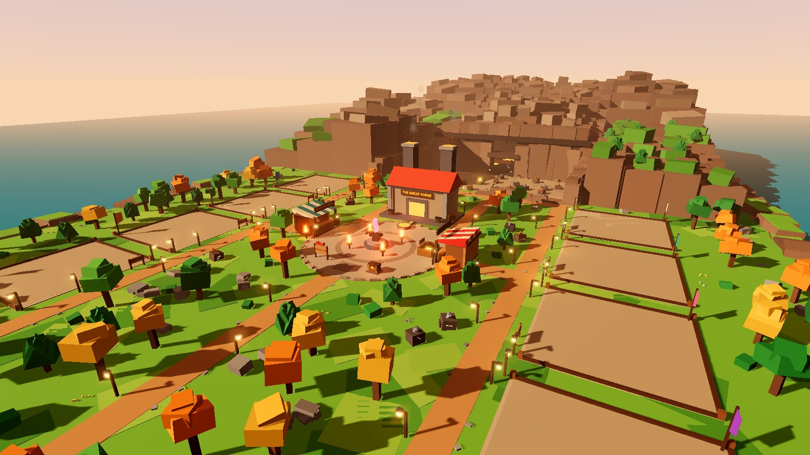
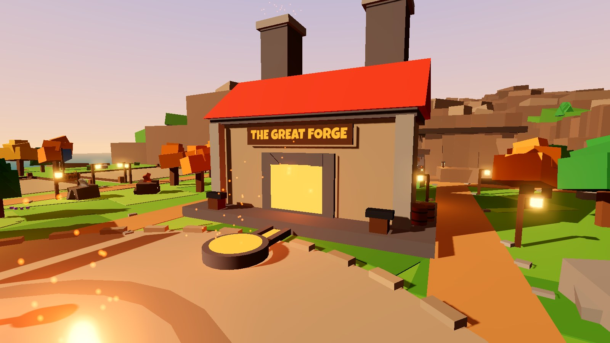
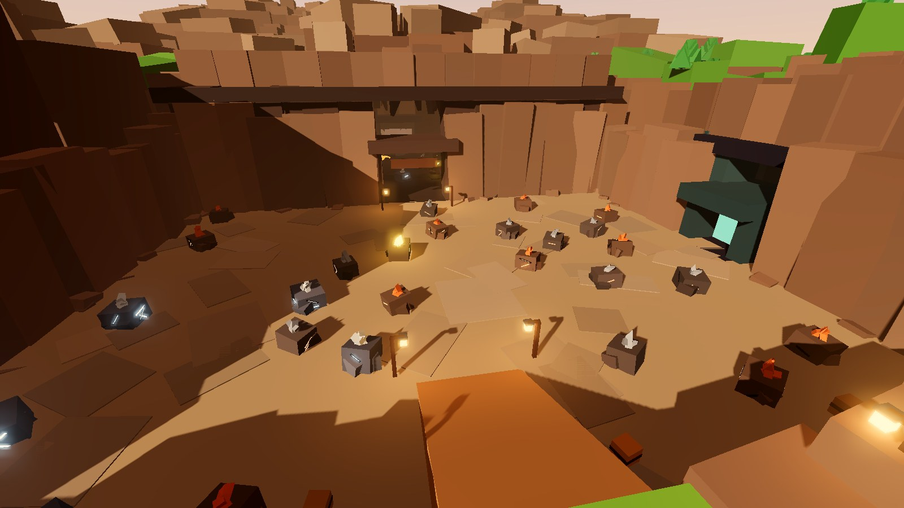
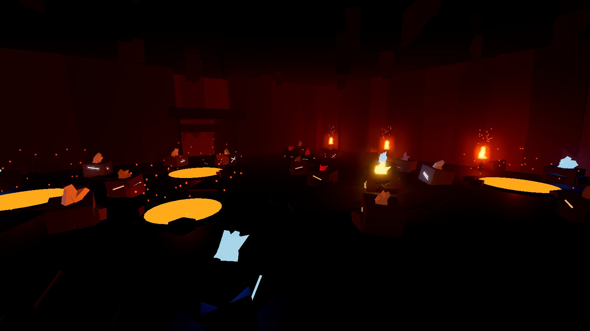
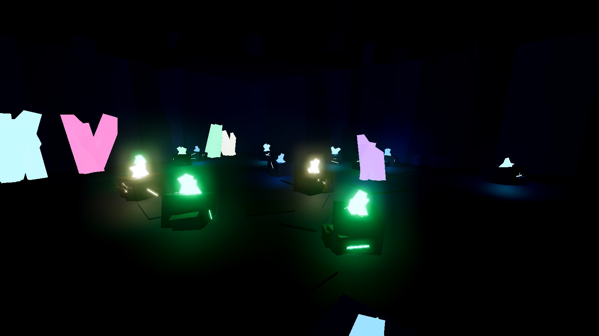

# TERRA FORGE

A cozy-but-epic Roblox mining and crafting game. Mine glowing ore, carry the chunks
by hand, **clean them on your workbench in a satisfying chisel → scrape → polish
minigame**, smelt them, forge gear and grow your workshop.

| | |
|---|---|
|  |  |
|  |  |

*Screenshots are offline preview renders of the generated map (tools/preview).*

## Status / continuing the work
Current state, branches and next steps: **[docs/HANDOFF.md](docs/HANDOFF.md)** (project rules for Claude: [CLAUDE.md](CLAUDE.md)).
Kenney Factory Kit (machine style reference): [docs/KENNEY_FACTORY_KIT.md](docs/KENNEY_FACTORY_KIT.md).

## Quick start
- **Just play / publish:** open `build/TerraForge.rbxl` in Roblox Studio → Play. See [docs/ROJO_SETUP.md](docs/ROJO_SETUP.md).
- **Česky:** [ZACNI_TADY.md](ZACNI_TADY.md)
- **Going live:** [PUBLISHING.md](PUBLISHING.md)

## Project layout
| Folder | In Studio | What |
|---|---|---|
| `src/shared` | ReplicatedStorage.Shared | configs (ores, items, machines, balance), builders, shared logic |
| `src/server` | ServerScriptService.Server | services (mining, items, saving, economy...) and the world generator |
| `src/client` | StarterPlayerScripts.Client | controllers (input, camera, VFX, UI) |
| `src/first` | ReplicatedFirst | loading screen |
| `tools/` | – | Lune tools (tests, map baking), preview renderer, check/build scripts |
| `docs/` | – | design, plan, QA reports, checklists |

Balance lives in `src/shared/Config/*`. Design summary: [docs/GAME_DESIGN.md](docs/GAME_DESIGN.md).
Art: style bible [docs/ART_DIRECTION.md](docs/ART_DIRECTION.md), lobby layout and build packages [docs/plans/LOBBY_PLAN.md](docs/plans/LOBBY_PLAN.md).

## Team (Claude subagents)
`.claude/agents/`: **game-designer** (plans), **luau-dev** (implements),
**qa-tester** (checks errors/exploits/saving/mobile), **asset-manager** (models/sounds/VFX).
