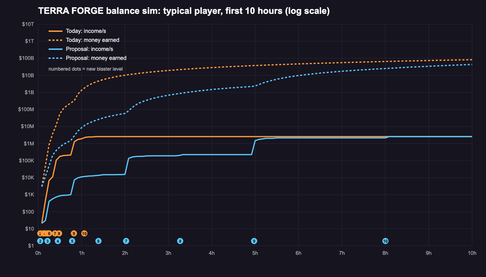

# Balance simulation (2026-10-18)

**Newest (2026-10-24, owner playtest): no Foundry, blasters from the Blaster Vault only.** The sim buys the next
level at the Vault for its coin scale (BlasterData.coins, the old Foundry prices: hoverboards, the lift, boosts,
quests and the rebirth stars follow it unchanged) x `Vault.PriceMultiplier`. `lune run tools/lune/balance_sim.luau
calibrate-vault` searches the multiplier for a Typical player at blaster 10 at 8 h: **1.15** (was 4 while the Foundry
was the cheaper way; with 3 free podiums). Rebirth runs: a level costs at least `RunShare` (0.5) x the first run's gap
(`RunSeconds`) of the income the factory kept (droppers, Podium Keeper; Stats.RunIncome) - rebirths are not modelled.

**Older numbers: "Re-run with steps 6–7 modelled" below.** The sections after it are the first runs (without steps 6–7).

A model of a typical player from the first minute to 10 hours, after the 36-ore roster from the owner's picture.
Script: `tools/lune/balance_sim.luau` (`lune run tools/lune/balance_sim.luau` for today's prices,
`... calibrate` for the price proposal); chart: `node tools/balance/chart.mjs` → `docs/screenshots/balance_chart.png`.
Raw output: `build/balance/sim.json`, `build/balance/proposal.json`. Nothing in the game config was changed.
Overrides without editing the script: `lune run tools/lune/balance_sim.luau [calibrate] override=my.json`, where
my.json is a JSON object merged into the assumptions table `A` (e.g. `IncomeMult`, `DamageMult`, `LuckMult`,
`CleanSpeedMult` for steps 6-7 bonuses, `BlasterCoins = {"4": 400000}`, `ElevatorPrice`, `Podiums`, `Players`) and
an optional `Scenarios` list.

**Re-run on integrate/steps67 (steps 6-7 merged onto main):** the tables and the chart below come from the merged
config. The one change the model sees: carrying is the Gear shop's Backpack line now (the `ToolData` shim reads
`GearConfig`), so carry upgrades cost 800 / 5,000 / 30,000 / 180,000 / 1.1M (before: 300 / 1,500 / 6,000 /
25,000). The rest of steps 6-7 is in the game but not in the model yet (see "Not modelled").

## Applied (balance pass 1, 2026-10-18)
The integrator applied the agreed proposals from the section below:
- BlasterData Recipe.Coins L2-L10: 330 / 12K / 380K / 1.5M / 29M / 51M / 1.2B / 2.1B / 35B (Typical blaster 10 at ~8 h).
- MachineData.AutoCleaner.Price 5,000 -> 25,000; in the Tech shop the Iron Box (12K) now comes before the Auto Cleaner.
- EnchantConfig coins x10 for the Epic (Twin Drop, Overcharge) and Legendary (Prospector, Golem Bond) enchants.
- BoostConfig HexaLucky5 ForgeShare 0.2 -> 0.02.
Waiting for the owner: the flat 3h-5h stretch (option 3 Tech Speed/Quality upgrades at higher prices, option 4 a floor
between 4 and 5, or both). The Foundry curve is re-calibrated to ~8 h after that choice, and the Quality upgrade
prices go up whichever option is picked.

## Foundry curve on the real 6 floors (2026-10-20, applied)

Calibrated on the live `MineFloors.List` (Stormglass Rift as floor 5, gate 8) with the option 3 Tech curves modelled
(the sim buys them by default now): BlasterData `Recipe.Coins` L2–L10 = **350 / 17K / 710K / 2.1M / 73M / 130M / 2.2B /
31B / 290B** (the elevator follows: 2/3 of L7 ≈ 87M; the coin hoverboards follow their levels).

| Milestone | Typical (50 %) | Skilled (80 %) | Casual (30 %) |
|---|---|---|---|
| Blaster 2 | 3m 00s | 2m 10s | 4m 15s |
| Blaster 4 | 27m 20s | 20m 25s | 35m 00s |
| Blaster 6 | 1h 20m | 1h 00m | 1h 47m |
| Elevator / floor 4 | 2h 21m | 1h 48m | 3h 13m |
| Blaster 8 / Stormglass Rift | 3h 16m | 2h 25m | 4h 40m |
| Blaster 9 / Heartstone Core | 5h 00m | 3h 30m | 7h 11m |
| Blaster 10 | **8h 00m** | 5h 26m | after 10 h |

Income 3h → 5h (typical): 0.79M/s → 5.2M/s (×6.6: no flat stretch any more). Tech upgrades of the typical player:
Auto Cleaner Speed I 27 min, Quality I 46 min, II 1h21, III 2h34, IV 5h01; Crusher Speed I 2h00.

## Option 3 (pricier Tech upgrades) and the 6-floor tables (2026-10-20)

The owner picked both fixes for the flat 3h–5h stretch: option 3 (pricier Tech Speed / Quality upgrades, this change)
and option 4 (the Stormglass Rift, gate 8, by the mine-floors chat). The sim now reads the real `MineFloors.List`
(the real tables reach about one rarity higher than the old "floor N = rarity N" model: with today's 5 floors a typical
player would reach blaster 10 at ~2h45, so the Foundry curve is re-calibrated once the Rift is in).

- `MachineData` base curves: Speed { 20K, 400K, 8M, 150M, 2.5B } (was { 2K, 12K, 70K, 400K, 2.5M }), Quality
  { 50K, 2M, 50M, 600M, 6B } (was { 5K, 40K, 300K, 2M, 15M }); each machine keeps its factor. With the 6-floor tables
  (variant A2, sent to the mine chat) a typical player buys Auto Cleaner Speed I at ~25 min, Quality I ~45 min,
  II ~1h20, III ~2h35, IV ~3h20 (between blaster 8 and 9); Quality V and the big machines' top Speed levels are goals
  past blaster 10.
- Calibrated with option 3 and the A2 tables (to be re-run on the Rift's real tables): Foundry L2–L10 ≈ 350 / 17K /
  710K / 2.1M / 73M / 130M / 3.0B / 38B / 290B; typical player: Rift (blaster 8) 3h16, Heartstone Core (blaster 9)
  5h01, blaster 10 7h57; skilled 5h32; casual reaches blaster 9 at 7h21.

## Re-run with steps 6–7 modelled (2026-10-18, branch fix/post-steps67)

The player now also buys Boots, the coin enchants (slotted where they earn most), coin golem capsules (on expected
gain, equipping the 3 golems that earn most), Hexa Lucky coin top-ups (when 5 minutes pay for themselves), the
Crystal Extractor and comfort items (Lamp, Gloves, Magnet, Reach, Magnetism, Prospector: no income effect in the model,
bought when they cost ≤ 10 % of the coins); finds artifacts (1 % per rock, deeper floors × 1.25 / × 1.5), gets shards
from duplicates and the extractor, restores a collection's last artifact and buys Epic / Legendary tiers with shards.
Every bonus goes through the real config (`GearConfig` / `EnchantConfig` / `GolemConfig` / `BoostConfig` /
`ArtifactConfig .stats`, `StatConfig.combine` caps) and acts on the model: DamagePct / OverchargePct on rock time,
walk speed on walking, ore luck on the ore draws (`BoostConfig.rarityMult`), TwinDropChance on ores per rock, SellPct on
sales, IncomePct on podium income. Not modelled: the daily wheel, Robux items, Triple Lucky, rebirths.
Two model fixes on the way: a player saving for the blaster still buys an item that pays back faster than the
saving takes (it brings the blaster closer), and the calibration continues each player from where they reached the
level before (checkpoints), so it runs in minutes.

**Result: with steps 6–7 bought by a sensible player, the ~8 h journey needs about 1.3–1.8 × the earlier proposal
from blaster 5 on.** Without the new prices the same player reaches blaster 10 at 5h40 (the steps 6–7 bonuses speed
the game up by about a third: sell +49–59 %, income +5 %, ore luck × 1.3, damage +35 %).

| Level | Today | Proposal before (no steps 6–7) | **Proposal with steps 6–7** |
|---|---|---|---|
| 2 | 250 | 240 | **330** |
| 3 | 2,000 | 14,000 | **12,000** |
| 4 | 15,000 | 370,000 | **380,000** |
| 5 | 100,000 | 1,100,000 | **1,500,000** |
| 6 | 700,000 | 23,000,000 | **29,000,000** |
| 7 | 5,000,000 | 34,000,000 | **51,000,000** |
| 8 | 35,000,000 | 810,000,000 | **1,200,000,000** |
| 9 | 250,000,000 | 1,400,000,000 | **2,100,000,000** |
| 10 | 1,500,000,000 | 23,000,000,000 | **35,000,000,000** |

| Milestone (proposal with steps 6–7) | Typical (50 %) | Skilled (80 %) | Casual (30 %) |
|---|---|---|---|
| Blaster 2 | 3m 00s | 2m 10s | 4m 15s |
| First machine bought | 4m 30s | 3m 00s | 6m 30s |
| Blaster 3 / floor 2 | 12m 10s | 9m 10s | 16m 40s |
| Blaster 4 | 25m 20s | 19m 35s | 33m 05s |
| Blaster 5 / floor 3 | 46m 30s | 36m 20s | 1h 00m |
| First Rare golem (≈ 80 %) | 1h 00m | 44m 00s | 1h 10m |
| Blaster 6 | 1h 21m | 1h 02m | 1h 46m |
| Blaster 7 / elevator / floor 4 | 2h 01m | 1h 37m | 2h 41m |
| Blaster 8 | 3h 14m | 2h 37m | 4h 21m |
| Blaster 9 / floor 5 | 5h 00m | 4h 10m | 6h 42m |
| First collection | 6h 39m | 4h 44m | 8h 16m (27 %) |
| Blaster 10 | 8h 02m | 6h 37m | after 10 h |

Today's prices with steps 6–7: blaster 8 at 28 min, blaster 10 at 52 min (before: 1h 03m).

### Where the steps 6–7 prices sit (proposal run, minutes of the Typical player's median income)
Income then: 3h15 ≈ 290K/s (blaster 7), 5h ≈ 340K/s (blaster 8: **flat from 3h to 5h**), 8h ≈ 3.4M/s (blaster 9).

| Item | at 3h15 | at 5h | at 8h |
|---|---|---|---|
| Each gear line, all 5 levels | < 0.1 | < 0.1 | < 0.1 |
| Common / Uncommon enchants, every tier | < 0.1 | < 0.1 | < 0.1 |
| Lucky III / Midas III (Rare) | 0.5 | 0.4 | < 0.1 |
| Twin Drop I / II / III (Epic) | 0.3 / 1.7 / 10 | 0.2 / 1.5 / 8.8 | < 0.1 / 0.1 / 0.9 |
| Overcharge I / II / III (Epic) | 0.2 / 1.4 / 8.2 | 0.2 / 1.2 / 7.0 | < 0.1 / 0.1 / 0.7 |
| Prospector I / II / III (Legendary) | 5.7 / 34 / 206 | 4.9 / 29 / 176 | 0.5 / 3.0 / 18 |
| Golem Bond I / II / III (Legendary) | 6.9 / 41 / 246 | 5.9 / 35 / 210 | 0.6 / 3.6 / 21 |
| Stone capsule | < 0.1 | < 0.1 | < 0.1 |
| Crystal capsule | 2.1 | 5.5 | 1.9 |
| Triple Lucky 5 min (coins) | 4.3 | 11 | 3.7 |
| Hexa Lucky 5 min (coins) | 14 | 21 | 35 |
| Auto Cleaner / elevator | < 0.1 | < 0.1 | < 0.1 |

### What the model shows
1. **Almost every steps 6–7 coin price is pocket change in both windows** (under a minute of income). Gear, all
   Common–Rare enchants and Stone capsules are bought in the first 1–3 hours; only the Legendary tiers, Crystal
   capsules and the boosts cost real time there. Nothing new to aim for lands in 3h15–5h or 5h–8h.
2. **Sell bonuses are what pays**: Midas III plus three Amethyst Acolytes (+7 % sell each, from cheap Stone
   capsules: 56 opened by 3h15) give sell +49 %. Mining-side bonuses (Power, Overcharge, Twin Drop, Luck and Mining
   golems) barely move the income after the first hour, because the train and the Auto Cleaners cap the delivered
   ore, not the mining speed: the model buys Power III and stops there.
3. **Hexa Lucky's coin top-up never pays for itself** (0 bought in 120 runs): 5 minutes cost 14–35 minutes of income
   (ForgeShare 0.2 of the next forge) and ×2.5 luck raises the income by far less. Triple Lucky only matters to
   someone opening many Crystal capsules.
4. **3h → 5h stays flat** (≈ 0.3M/s): blaster 8 opens no floor, so the player only saves for blaster 9.
5. **Casual players** (30 %) don't reach blaster 10 within 10 hours with these prices.

### Per-config-key proposals (for the integrator; the sim re-runs in minutes after any change)
- `BlasterData` `Recipe.Coins` levels 2–10: the "with steps 6–7" column above.
- `MachineData.AutoCleaner.Price`: 5,000 → **25,000** (the first cleaner lands at 10–15 min today; ~25–30 min keeps
  the cleaning minigame the main way to clean for the first half hour). Re-calibrate after the change.
- `EnchantConfig` coin prices, to give the windows goals: Epic (Twin Drop, Overcharge) **× 10** (50M / 300M / 1.8B and
  40M / 240M / 1.44B: 3 / 17 / 100 min at 3h15), Legendary (Prospector, Golem Bond) **× 10** (1B / 6B / 36B and 1.2B /
  7.2B / 43B: about 5 / 30 / 180 min at 8h, the last tiers a post-blaster-10 goal). Shard prices unchanged (the shard
  path stays the shortcut for collectors). Common–Rare unchanged (early-game lines).
- `BoostConfig.CoinOffers.HexaLucky5.ForgeShare`: 0.2 → **0.02** (≈ 1.5–3.5 min of income for 5 min: a real choice
  in the windows instead of never).
- `CapsuleConfig.LevelScale`: unchanged (a Crystal capsule costs 2–6 min of income in the windows: a fair repeatable
  sink). `GearConfig` prices: unchanged (gear finishes in the first 3–5 hours).
- Bigger lever for the flat 3h–5h stretch: something that raises **delivery**, not mining (train capacity / speed
  levels past today's last, a 5th Auto Cleaner, machine Speed / Quality upgrades), or a floor between 4 and 5. Those
  are design calls; the sim can test any of them.

### Options for the flat 3h–5h stretch (Typical, 120 players)
All runs on the steps 6–7 proposal prices plus the agreed changes (Auto Cleaner 25K, Epic / Legendary enchant coins
× 10, Hexa Lucky ForgeShare 0.02). Override files: `MachinePrices`, `EnchantCoinMult`, `HexaForgeShare`,
`TrainCapacityExtra`, `TrainSpeedExtra`, `MaxCleaners`, `MachineUpgrades` (+ `UpgradePriceMult`), `ExtraFloor`.

| Option | Blaster 10 | Income 3h → 5h |
|---|---|---|
| Base (agreed changes only) | 8h 07m | 286K → 331K/s (× 1.16) |
| 1. More train levels (capacity 70 / 100 / 140 for 40M / 300M / 2B, trip 10 s / 8 s for 60M / 400M) | 8h 07m | × 1.16 (never bought) |
| 2. A 5th Auto Cleaner (25K) | 8h 07m | × 1.16 (never bought) |
| 3. Tech shop Speed / Quality upgrades at today's prices (Auto Cleaner Speed + Quality, Crusher Speed) | 5h 21m | 583K → 5.37M/s (× 9.2) |
| 3b. The same upgrades at × 100 prices (Quality 4 = 200M lands at 4h17) | 6h 22m | 374K → 4.76M/s (× 12.7) |
| 4. A floor between 4 and 5 (gate 8, elevator, best Epic + cheapest Legendary ores 50/50) | 6h 57m | 286K → 3.14M/s (× 11.0) |

Why 1 and 2 do nothing: a typical player mines about 0.4 ores/s, while 4 Auto Cleaners clean 0.5/s and the top train
carries 2.2/s, so neither is the bottleneck. Options 3 and 4 work because they raise the value per ore (cleaner
grades, better ores) or open a floor in the gap. Each of them makes blaster 10 earlier, so the Foundry curve needs a
re-calibration after the choice (`lune run tools/lune/balance_sim.luau calibrate override=<the option>.json`).



## What the model does
- Reads the real config: OreData (36 ores, Income, Value = Income × 30), ItemData (grades, Raw 0.4 / Crushed 0.75 /
  Ingot 1.25), BlasterData (damage, Foundry recipes, Vault = 4 × coins), MachineData (prices, times, power),
  ToolData (carry: the Gear shop's Backpack levels and prices through the ToolData shim), TrainConfig (capacity,
  trip seconds).
- Mine floors as built on `art/mine-floors` (MineFloors.luau): blaster gates 1 / 3 / 5 / 7 / 9, floors 4–5 only with
  the $500K elevator, rocks that the floor's weakest allowed blaster breaks in ~4.5 s, 3.3 ores per rock. Ore tables
  follow the mine chat's plan for the new roster: floor N = the Nth rarity; 10 % crystal rocks roll from the floor's
  best 3 ores (70 %) or the next rarity's cheapest 3 (30 %). Weights inside a table fall with value (1 / rank^0.8).
- Player loop per 5 s step: mine → carry to the floor's train (12 s walk per load) → train to the pen → clean by
  hand (12 s per ore + the trip back; 18 s before the strong spray of 2026-10-25, which moved Typical's blaster 10 from
  7h45 to 7h42 and the first hour by 1-2 minutes, measured with 2 free podiums) until the first Auto Cleaner (8 s per
  ore, Quality 0 odds) → best 3 cleaned ores on the 3 free podiums (2 before 2026-10-24) → the rest sold, through the
  Crusher (×2) and furnaces (ingots ×1.25) when owned.
- Buying (greedy): the next blaster as soon as ingots + coins are there (Foundry) or the Vault is affordable; the
  elevator once floor 4 is in reach; hoverboards ($5K / $80K / $1.5M, walking × 0.8 / 0.65 / 0.5) when they cost at
  most a quarter of the coins; otherwise the machine / upgrade with the best payback under 20 min (carry levels, train
  capacity and speed, up to 4 Auto Cleaners, Crusher, Brick → Blast → Plasma furnace with the cheapest power).
- Player types: efficiency = how well the player's own actions go (mining, walking, hand cleaning); machines run full.
  Typical 50 %, Skilled 80 %, Casual 30 %. 120 players each (seeded ore draws), medians.
- Not modelled: steps 6–7 are merged but not modelled yet: gear except the Backpack (everyone walks at Boots 0's
  16 studs/s; old saves' 18 is Boots I now), golems, boosts, enchants, capsules, the daily wheel and artifacts (the
  `IncomeMult` / `DamageMult` / `LuckMult` / `CleanSpeedMult` overrides stand in for their bonuses). Also not:
  rebirths, machine Speed / Quality upgrades, podiums 4–5 (Robux), offline earnings, the Grotto, Golden / Geode
  rocks and the Giant Crystal.

## Today's prices
| Milestone | Typical (50 %) | Skilled (80 %) | Casual (30 %) |
|---|---|---|---|
| Floor 1 | 0m 05s | 0m 05s | 0m 05s |
| First podium filled | 1m 05s | 0m 40s | 1m 50s |
| Blaster 2 | 2m 55s | 2m 00s | 4m 20s |
| First machine bought | 5m 00s | 3m 30s | 6m 30s |
| Floor 2 | 7m 25s | 5m 00s | 12m 00s |
| Blaster 3 | 7m 25s | 5m 00s | 12m 00s |
| Blaster 4 | 9m 15s | 6m 40s | 14m 20s |
| Hoverboard 1 ($5000) | 9m 55s | 7m 25s | 14m 10s |
| Floor 3 | 12m 45s | 9m 20s | 18m 40s |
| Blaster 5 | 12m 45s | 9m 20s | 18m 40s |
| Hoverboard 2 ($80000) | 14m 05s | 10m 10s | 20m 55s |
| Blaster 6 | 15m 15s | 11m 10s | 22m 25s |
| Blaster 7 | 23m 20s | 18m 05s | 32m 15s |
| Elevator bought | 24m 00s | 18m 35s | 33m 00s |
| Floor 4 | 24m 00s | 18m 35s | 33m 00s |
| Hoverboard 3 ($1500000) | 25m 10s | 19m 30s | 34m 40s |
| Blaster 8 | 28m 50s | 22m 25s | 39m 45s |
| Blaster 9 | 49m 25s | 40m 50s | 1h 05m |
| Floor 5 | 49m 25s | 40m 50s | 1h 05m |
| Blaster 10 | 1h 03m | 52m 10s | 1h 25m |

## Proposal: Foundry coin prices calibrated to a ~8 h journey
Targets for the Typical player: blaster 2 at 3 min, 3 at 12 min, 4 at 25 min, 5 at 45 min, 6 at 1h20, 7 at 2h,
8 at 3h15, 9 at 5h, 10 at 8h. Ingot recipes, Vault multiplier (4 ×) and everything else unchanged.

| Level | Today | Proposal | × today |
|---|---|---|---|
| 2 | 250 | 240 | 0.96 |
| 3 | 2,000 | 14,000 | 7.0 |
| 4 | 15,000 | 370,000 | 25 |
| 5 | 100,000 | 1,100,000 | 11 |
| 6 | 700,000 | 23,000,000 | 33 |
| 7 | 5,000,000 | 34,000,000 | 6.8 |
| 8 | 35,000,000 | 810,000,000 | 23 |
| 9 | 250,000,000 | 1,400,000,000 | 5.6 |
| 10 | 1,500,000,000 | 23,000,000,000 | 15 |

| Milestone | Typical (50 %) | Skilled (80 %) | Casual (30 %) |
|---|---|---|---|
| Floor 1 | 0m 05s | 0m 05s | 0m 05s |
| First podium filled | 1m 05s | 0m 40s | 1m 50s |
| Blaster 2 | 2m 50s | 2m 00s | 4m 15s |
| First machine bought | 5m 00s | 3m 30s | 6m 30s |
| Floor 2 | 12m 50s | 9m 55s | 17m 20s |
| Blaster 3 | 12m 50s | 9m 55s | 17m 20s |
| Hoverboard 1 ($5000) | 14m 55s | 11m 30s | 19m 20s |
| Hoverboard 2 ($80000) | 24m 00s | 19m 20s | 31m 00s |
| Blaster 4 | 27m 10s | 21m 55s | 35m 00s |
| Floor 3 | 46m 55s | 39m 45s | 58m 05s |
| Blaster 5 | 46m 55s | 39m 45s | 58m 05s |
| Hoverboard 3 ($1500000) | 58m 40s | 50m 10s | 1h 13m |
| Blaster 6 | 1h 23m | 1h 13m | 1h 42m |
| Blaster 7 | 2h 01m | 1h 50m | 2h 26m |
| Elevator bought | 2h 02m | 1h 50m | 2h 27m |
| Floor 4 | 2h 02m | 1h 50m | 2h 27m |
| Blaster 8 | 3h 16m | 2h 56m | 3h 58m |
| Blaster 9 | 4h 58m | 4h 34m | 6h 05m |
| Floor 5 | 4h 58m | 4h 34m | 6h 05m |
| Blaster 10 | 8h 00m | 7h 05m | 9h 52m (46 % reach it) |

The saw-tooth (cheap 5 / 7 / 9, expensive 6 / 8 / 10) comes from the floor gates: the odd levels open a floor whose ores
are worth about 10 × the floor before, so the level after it has to cost a lot more to keep the pace.

## Spots that look too fast or too slow
1. **Far too fast overall (today).** A typical player has blaster 10 and all 5 floors after about **1 hour** (casual
   1h25). After that nothing is left to buy: income stays flat for 9 hours (the orange line). Main causes: each floor's
   ores earn about 10 × the floor before while a blaster level costs about 7 × the one before; Auto Cleaners make the
   income independent of the player's time; Crusher + furnace turn every ore into 2.5 × its value.
2. **The cleaning minigame (the signature) is automated after ~5–10 minutes**: the first $5,000 Auto Cleaner pays back
   so fast that hand cleaning stops being worth it. A higher price (e.g. $25K–$50K) or the cleaner in a later step
   would keep the minigame alive for the first half hour.
3. **The elevator is trivial**: $500K arrives when blaster 7 costs $5M (today) or $34M (proposal). Proposal: about
   **$23M** (about 2/3 of blaster 7), so it is a real goal before floor 4.
4. **Hoverboards** ($5K / $80K / $1.5M) land at 15 / 24 / 59 min with the proposal (10 / 14 / 25 min today). The third
   one could cost more (e.g. $5M) to stay a goal past the first hour.
5. **Dead zones even with the proposal**: 3h15 → 5h (income flat at ~200K/s, nothing new to buy after the blaster 8
   machines) and 5h → 8h (saving for blaster 10). Steps 6–7 (golems, boosts, enchants, capsules, artifacts) and
   machine Speed / Quality upgrades should land as goals in these windows.
6. **Early game is fine**: first podium in about a minute, first machine at 3–7 min, blaster 2 at 2–5 min.
7. **Skill matters little later on**: Skilled and Casual players end only ~1 h apart from Typical, because machines
   do most of the work after the first hour. Player-driven bonuses (hand-cleaning quality, mining combos, Giant
   Crystal) would give active players more edge.

## Who decides
Blaster / step 6 prices and balance: "TERRA FORGE Roblox hra vývoj" (integrator). Floors, elevator and hoverboard
prices: the mine-floors chat. This file only proposes; nothing here changes the game.

## The 2x Money pass (2026-10-21)

The pass doubles podium income (offline too) and every sale, outside the StatConfig caps
(`EconomyService.addIncomeFactor` "MoneyPass", `Bonuses.sellMult`). The sim's `IncomeMult`
assumption does exactly that ("podium income and every sale"), so a payer is:

```bash
echo '{"IncomeMult":2}' > build/balance_2x/x2.json
lune run tools/lune/balance_sim.luau override=build/balance_2x/x2.json
```

Medians of 120 players each, same seed, main at 75ecbd5 (no Acts bonus, no Starter Pack):

| Profile | Blaster 9 free | Blaster 9 with 2x | Blaster 10 free | Blaster 10 with 2x | Faster |
|---|---|---|---|---|---|
| Typical (0.5) | 5h 00m | 2h 33m | 8h 00m | 4h 04m | x1.97 |
| Skilled (0.8) | 3h 30m | 1h 53m | 5h 26m | 2h 53m | x1.88 |
| Casual (0.3) | 7h 11m | 3h 37m | past 10 h | 5h 54m | x1.99 (blaster 9) |

Inside the owner's rule (a paying player ~2-3x faster, target 1.6-2.5x for this pass alone):
the pass halves the coin grind but not the time spent on non-coin gates, so it lands just
under x2. It buys no story step and no mega machine. The Starter Pack (one Rare +10 % income
golem and 20 minutes of income once) is a one-time head start of minutes, not a multiplier.
With the Acts income bonus (feature/acts, also outside the cap) the pass doubles that too:
re-run this table on the Acts branch when it lands.

## Player levels (2026-10-21)

The player LEVEL (LevelConfig, LevelService): XP from the save's counters, level-up coins
(max(25 x level, 45 s of podium income), x5 every 10th level) and +1 % podium income per
level (cap +50 % at level 51, outside the IncomePct cap; stacks with the 2x Money pass).
The model (`A.Levels`, off by default) pays XP per 5 s step with the game's weights on its
flows (rocks, ores, cleans, sales, active play time, one Upgrades weight per buy).

```bash
echo '{"Levels":true}' > build/balance_lv/lv.json
echo '{"Levels":true,"IncomeMult":2}' > build/balance_lv/lv2.json
lune run tools/lune/balance_sim.luau override=build/balance_lv/lv.json
```

Median of 120 players per profile:

| Profile | Blaster 10 | with levels | Faster | 2x pass | 2x + levels | Faster |
|---|---|---|---|---|---|---|
| Typical | 8h 00m | 7h 32m | 5.8 % | 4h 04m | 3h 51m | 5.3 % |
| Skilled | 5h 26m | 5h 12m | 4.3 % | 2h 53m | 2h 46m | 4.0 % |
| Casual | (B9 7h 11m) | (B9 6h 42m) | 6.7 % | 5h 54m | 5h 33m | 5.9 % |

Levels reached (Typical): 10 at 48 min, 20 at 2h 25m, 30 at 6h. Skilled: 40 at 7h.
Every case stays under the 10 % limit the integrator set, so the +1 %/level share and the
+50 % cap stay as they are.
